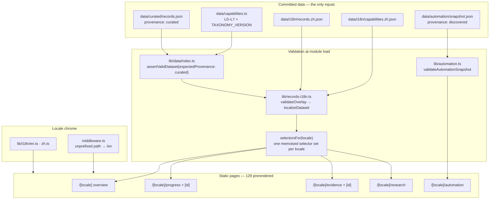
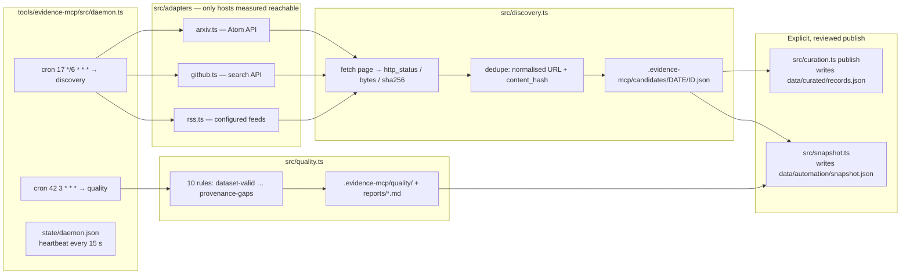
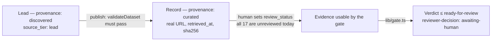

# Architecture

## 1. Current scaffold

The repository is a Next.js App Router application with TypeScript and Tailwind CSS. The UI renders a clearly labeled, fictional demonstration dataset held in the repository; no ingestion, persistence, or model calls exist. Routes, components, data flow, and the client-side stage gate are described in [frontend.md](frontend.md).

## 2. Logical components

1. **Source adapters** — retrieve metadata and content from approved sources such as papers, technical reports, benchmark pages, GitHub repositories, and official announcements.
2. **Raw-source archive** — retain canonical URL, retrieval time, content hash, metadata, and an immutable or versioned snapshot where licensing and policy permit.
3. **Extraction pipeline** — generate candidate entities and claims in a structured schema with source spans or exact supporting passages.
4. **Verification pipeline** — validate source support, check dates and context, identify duplicates, and find independent evaluation or counterevidence.
5. **Assessment engine** — map accepted evidence to explicit capability criteria and produce a proposed assessment, rationale, uncertainty, and unresolved gaps.
6. **Review gate** — require configured review for stage changes and preserve an audit trail.
7. **Application API** — serve filtered records and submit review actions.
8. **Dashboard** — visualize evidence, assessment history, attribution hypotheses, and forecast calibration.

## 3. Suggested deployment stack

- Next.js App Router + TypeScript + Tailwind CSS.
- PostgreSQL for relational records and full-text search initially.
- Optional object storage for source snapshots and extracted artifacts.
- A server-side model adapter supporting structured output and explicit model/version metadata.
- Vercel for the frontend and short request handlers.
- A durable job runner or queue for long-running workflows, retries, backoff, cancellation, and resumable progress.

Do not assume a serverless request is suitable for an entire research run. The web layer should enqueue work and expose job status. Choose a durable workflow service only after the expected job duration, throughput, and cost are known.

## 4. Data flow

```text
Sources
  -> Capture and archive
  -> Candidate claims
  -> Source-support verification
  -> Independent evidence and counterevidence
  -> Capability mapping
  -> Assessment proposal
  -> Review gate
  -> Versioned assessment
  -> Dashboard and reports
```

## 5. Reliability and safety

- Every generated record stores the model/provider and prompt or workflow version where applicable.
- Preserve original source timestamps separately from retrieval timestamps.
- Use idempotency keys for source ingestion and job retries.
- Make extraction and assessment jobs resumable.
- Apply rate limits and per-source budgets.
- Treat source text as untrusted input; it must never override system or developer instructions.
- Never let a model-generated claim self-verify.
- Keep secrets in environment variables and out of browser bundles.
- Use explicit status transitions and audit records for reviewer actions.

## 6. Initial implementation order

1. Static dashboard and docs. *(Done: five views plus detail pages, and since the curated dataset landed the pages render agent-maintained records rather than the demo fixture; see [frontend.md](frontend.md).)*
2. Typed domain schemas and database migration. *(Half done: `lib/types.ts` defines the shapes and `lib/validate.ts` enforces them at runtime — ids, references, version chains, provenance, forecast resolution — run on every build via `npm run validate:data`. No database migration yet; that needs a persistence decision.)*
3. Manual source/claim/evidence entry. *(Half done, and not the way round the plan expected: the entry path is the agent's — `npm run evidence:run -- curation` writes a working copy and `publish` validates it with the same validator the build runs before it becomes `data/curated/records.json`. There is no human data-entry form, and nothing is human-reviewed yet: every published evidence record is `review_status: "unreviewed"`.)*
4. Search and provenance views. *(Started: the Evidence Explorer keeps its search and facet state in the URL so a filtered view is linkable, and every record page renders a provenance panel that shows only stored fields and states what the record does not establish. The records are now curated rather than fictional, so those panels show real URLs, retrieval times and content hashes. Search is still client-side.)*
5. Assisted extraction with validation.
6. Counterevidence discovery and review queue. *(Half started: `tools/evidence-mcp/` discovers candidate sources from arXiv, the GitHub search API, and configured RSS/Atom feeds, stores each as a lead with its retrieval facts, and records a triage decision with a required reason. `/automation` renders a committed snapshot of that store, so what was discovered is visible and its age is stated. There is no review queue in the dashboard yet — triage happens through the tool — and nothing is promoted automatically; see [automation.md](automation.md).)*
7. Versioned assessments and forecast scoring.
8. Scheduled ingestion and durable workflows. *(Half started: a local daemon runs discovery every six hours and the quality audit nightly, with a heartbeat, run log, single-flight locks, and a Windows logon task. It is a scheduler over a state file, not a durable queue: an interrupted run is recorded as failed, not resumed, and there is no database to ingest into.)*

The list does not name internationalisation, which arrived as a cross-cutting change: every route is now under `/en` or `/zh`, chrome strings live in `lib/i18n/`, and record prose plus the L0–L7 taxonomy are translated by validated overlays in `data/i18n/`. Quotations are never translated. See [frontend.md](frontend.md) §2.


## 7. How the pieces connect

Three diagrams: what the build reads, what the daemon produces, and where the
promotion boundaries sit. Everything they name is committed and checked by
`npm run validate:data` / `npm test`; nothing in the store is read at runtime.

### 7.1 Build-time rendering



### 7.2 The scheduled loop



`.evidence-mcp/` is gitignored: the daemon runs on one machine and the site
never reads it. Only the two JSON files above cross into the repository, and
each one is written by a command somebody ran on purpose.

### 7.3 Trust boundaries



Nothing crosses a boundary by itself. A lead never becomes a record inside the
tool, a record never becomes accepted evidence without a human `review_status`,
and the gate never returns `accepted` — it stops at `ready-for-review`.
